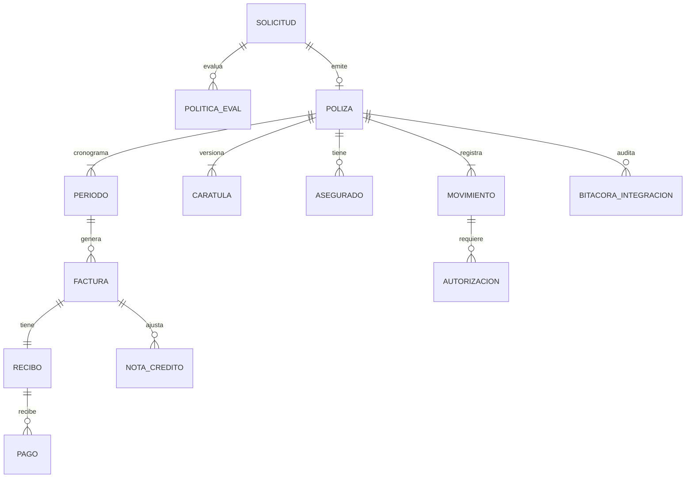

# 06 · Modelo de dominio

**Estados.** Solicitud: BORRADOR → RADICADA → EN_ESTUDIO → EMITIDA | RECHAZADA. Póliza: VIGENTE | ANULADA. Recibo: PENDIENTE, PARCIAL, LEGALIZADO, EN_MORA, ANULADO (+CRUZADO, PENDIENTE_REEMBOLSO, REEMBOLSADO).

**Productos AP:** Accidentes Personales Colectivo, Accidentes Personales Corto Plazo, Accidentes Personales Generación Positiva, Accidentes Personales Complemento Riesgos Laborales, Accidentes Personales Individual, Accidentes Personales Individual Bicibles, Accidentes Personales Individual Viajero.

**Políticas de suscripción:** | ID | Nombre |
|---|---|
| P01 | Faltan datos SARLAFT |
| P02 | Retroactividad excede límite permitido |
| P03 | Edad de ingreso inferior a la permitida |
| P04 | Póliza no cumple con la prima mínima establecida |
| P05 | Porcentaje de comisión excede límite permitido |
| P06 | Porcentaje de retorno excede límite permitido |
| P07 | Porcentaje de comisión y retorno excede límite establecido |
| P08 | Valor Asegurado excede límite |

**Persistencia:** SQLite (`node:sqlite`), almacén por colecciones con transacción atómica (rollback descarta todo; la bitácora de integraciones sobrevive).

